# Retail Intelligence

**Three questions every retailer asks, answered end to end on real data:**

1. **Customers:** who will buy again in the next 90 days, why, and what should marketing do about it?
2. **Demand:** how many units of each product will be ordered in the next four weeks?
3. **Pricing and promotions:** how sensitive is each product to price, which promotions pay, and what should change?

Each question has its own storytelling notebook, tested dbt models, validated models, a page in a production dashboard, and tools for an AI analyst that answers business questions with the same engines.

[](https://github.com/marianunez-data/retail-intelligence/actions/workflows/ci.yml)
&nbsp;Run the app locally or with Docker in a few minutes: see [Quickstart](#quickstart).

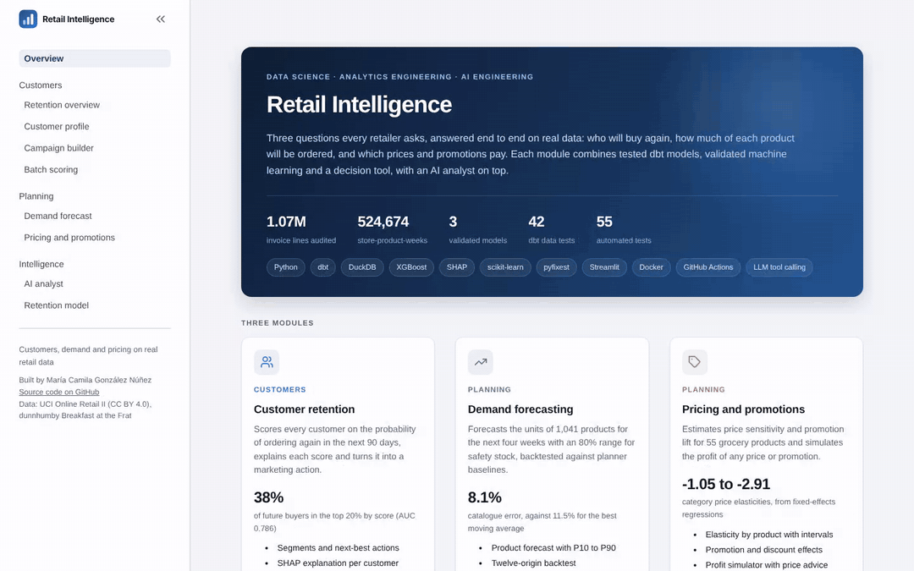

*A 40-second tour: a frozen pizza promotion simulated with discount, circular and display; an at-risk customer rescored after a win-back purchase; a four-week demand forecast with its 80% range.*

---

## Results at a glance

| Module | Data | Headline result |
|---|---|---|
| **Customer retention** ([notebook 01](notebooks/01_retention_analysis.ipynb)) | UCI Online Retail II: 1.07M invoice lines, 5,852 customers | Holdout AUC **0.786**; the top 20% of customers by score hold **37.6%** of future buyers (1.9x lift); ranking holds out of time (AUC 0.794) |
| **Demand forecasting** ([notebook 02](notebooks/02_demand_forecasting.ipynb)) | Same retailer: 1,041 products x 104 weeks | Catalogue-level error **8.1%** vs 11.5% for the best moving average; product-level WAPE 47.5% vs 49.0%; bias +3.6% vs -9.4%; calibrated 80% intervals cover **81%** of outcomes |
| **Pricing and promotions** ([notebook 03](notebooks/03_pricing_and_promotions.ipynb)) | dunnhumby *Breakfast at the Frat*: 524,674 store-product-weeks, 77 stores | Elasticities from **-1.05** (oral hygiene) to **-2.91** (frozen pizza); circular and display add **20 to 60%** lift; discounts under 10% do nothing; out-of-time WAPE **34.9%** vs 46.6% for a store-product average |

All numbers are written by the pipelines into [`reports/`](reports) and [`data/processed/`](data/processed), and match the notebooks.

## What this project shows

| Role | Evidence |
|---|---|
| **Data Scientist** | Problem framing and target design; data audits turned into rules; three-layer validation (cross-validation, holdout, out-of-time); rolling-origin forecast backtests against planner baselines; calibration and conformal prediction intervals; SHAP; a difference-in-differences natural experiment; fixed-effects elasticity models with clustered errors and partial pooling; promotion economics; honest limitations in every notebook |
| **Analytics Engineer** | dbt on DuckDB with two sources, staging, intermediate and mart layers by domain, a seed for category rules, parameterised point-in-time snapshots, 40+ data tests (label leakage, demand grid completeness, panel uniqueness, value ranges), documented cleaning rules traced back to each audit |
| **AI Engineer** | Tool-calling agent on any OpenAI-compatible API (Gemini free tier by default) with nine tools across three domains, guarded text-to-SQL on a sandboxed DuckDB, transparent analysis steps, agent loop tested with a scripted fake LLM |
| **Pricing, revenue and demand roles** | Own-price and promotional elasticities by product, discount-depth thresholds, pantry-loading and cannibalization tests, profit simulator with margin assumptions, Lerner-rule price recommendations, demand classification (Syntetos-Boylan), safety-stock ranges |
| **ML / production** | Installable package shared by notebooks, app and tests; Docker image that trains at build time; CI with 55 unit, agent and end-to-end pipeline tests plus a container health check; ready for free cloud hosting |

## Architecture

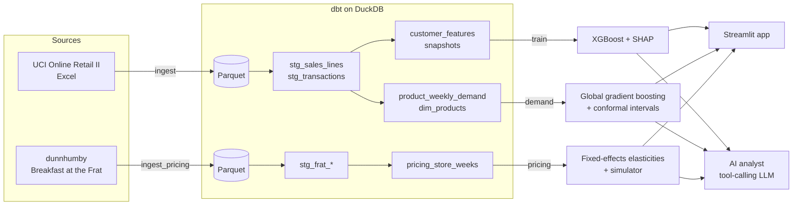

## The three laboratories

### 01 Customer retention

Snapshot design that prevents leakage (features before a cutoff, label in the 90 days after), data audit of 1.07M lines, EDA, model comparison by repeated cross-validation, holdout and out-of-time validation, SHAP explanations, segments and next-best actions.

| | |
|---|---|
| 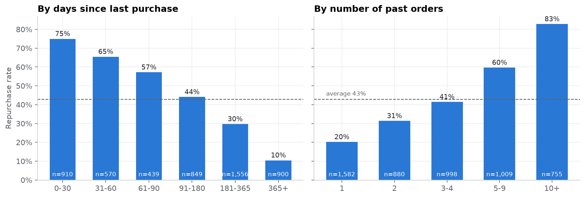 | 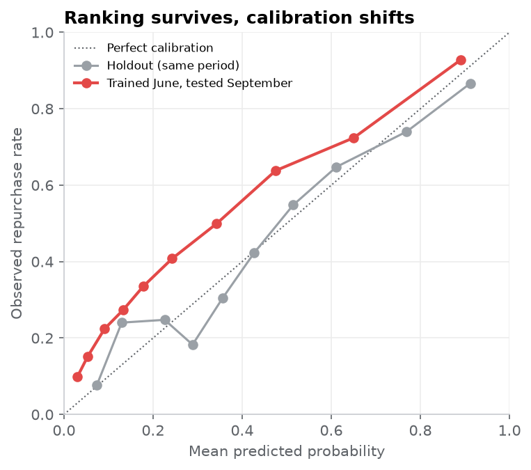 |

**Key finding:** seasonality moves probabilities, not rankings. A model trained in June predicted 31% repurchase for September; 43% happened, yet the ranking was as good as on the holdout.

### 02 Demand forecasting

A complete product-week grid built in dbt (guest orders included, Christmas closures as explicit zeros), seasonality by category, demand classification, the retailer's price architecture (list, volume tiers, guest prices), and a natural experiment on list-price changes. One global gradient boosting model (Poisson and quantile losses, features relative to each product's level) is backtested at twelve origins against four planner baselines, with conformal calibration of the intervals and a feature-group ablation.

| | |
|---|---|
| 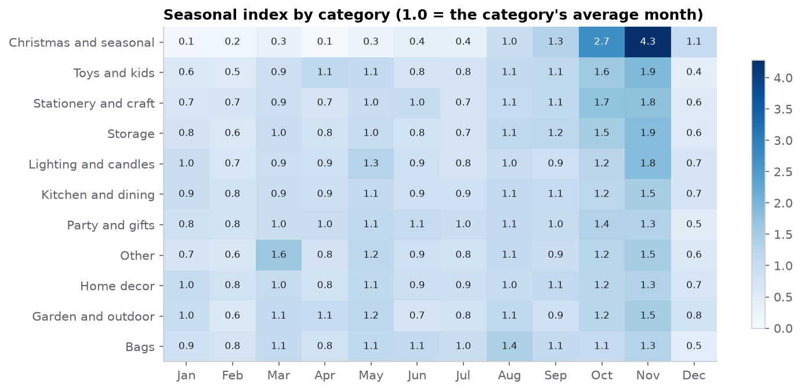 | 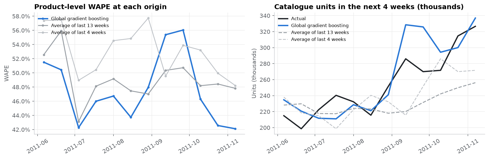 |

**Key findings:** most products are *erratic* (they sell nearly every week but in lumpy quantities), so the four-week purchasing quantity is the right forecast grain. The model's main gain is on the catalogue total and on bias during the autumn ramp, which moving averages always trail. A difference-in-differences on 75 list-price changes finds elastic demand (about -2) but with wide intervals and no promotions, which is why pricing continues in notebook 03.

### 03 Pricing and promotions

Data audit (including a duplicated store lookup caught by a dbt test), price ladders, promotion mechanics, a step-by-step demonstration of why a naive regression understates elasticity, product-level elasticities with clustered standard errors and partial pooling, promotion lifts, a discount-depth threshold, pantry-loading and cannibalization tests, out-of-time validation, promotion economics and price recommendations.

| | |
|---|---|
| 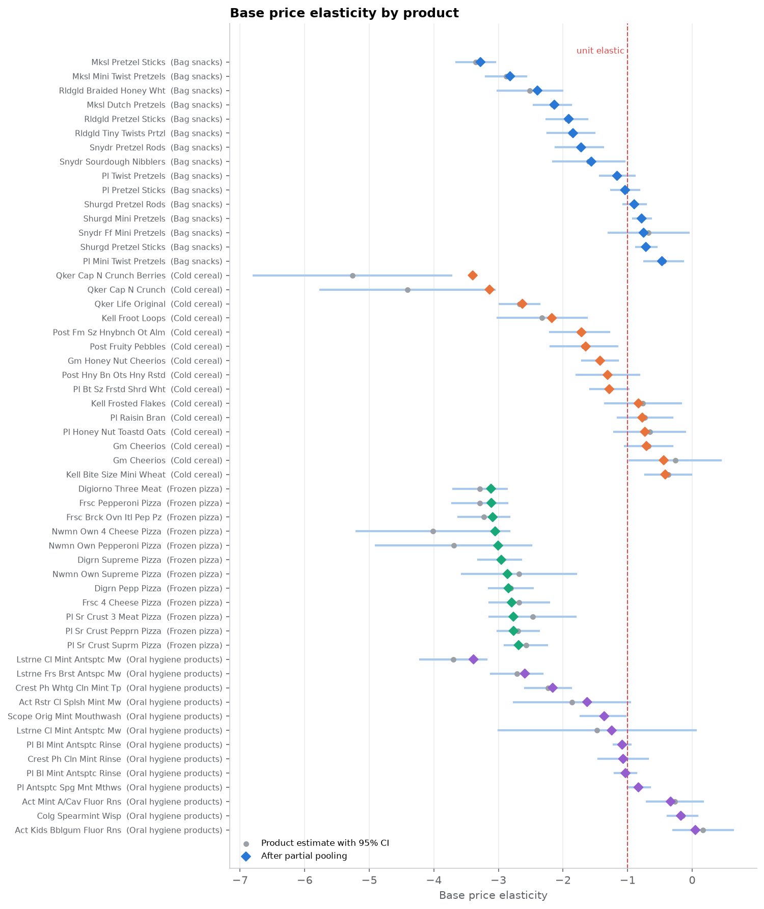 | 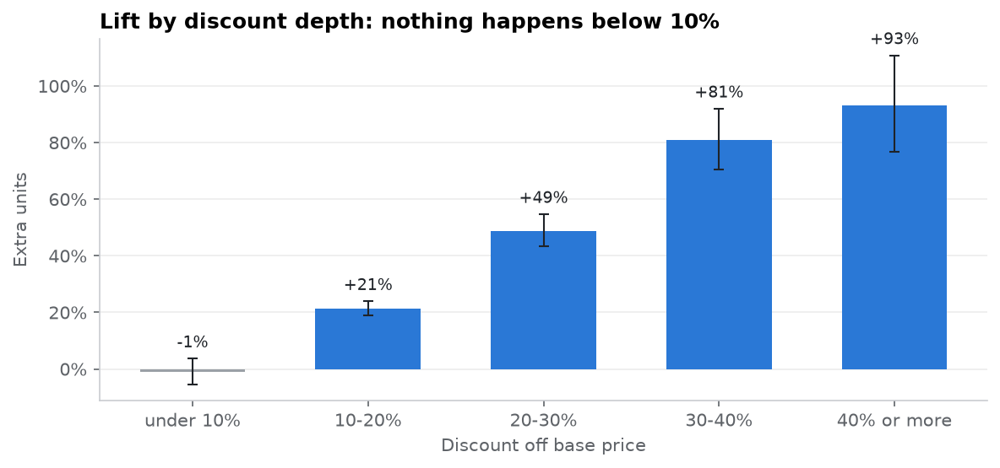 |

**Key findings:** fixed effects move the average elasticity from -0.98 (naive) to -1.73; frozen pizza is the price-sensitive category; promotional support, not the shelf tag, drives lift; cereal promotions take about 20% of their lift from other products on the same shelf; at a 30% margin, tag-only promotions lose 35 to 60% of a regular week's gross profit.

## The application

| Section | Page | Purpose |
|---|---|---|
| Home | Overview | The three modules, headline results and where to start |
| Customers | Retention overview | KPIs, segment mix, recommended actions, priority win-back list |
| | Customer profile | Score, SHAP explanation, what-if scenario |
| | Campaign builder | Filter and export contact lists |
| | Batch scoring | Score an uploaded CSV |
| Planning | Demand forecast | Four-week forecast per product with 80% range, history chart, backtest accuracy, export |
| | Pricing and promotions | Elasticities by product, promotion lifts, simulator for price, discount, circular and display with an adjustable margin, profit curve and recommendation |
| Intelligence | AI analyst | Questions in plain English across customers, demand and pricing |
| | Retention model | Gains, calibration, SHAP, model comparison, methodology |

Every page has a *How to read this page* guide, and every KPI and table column explains itself on hover.

| | |
|---|---|
| 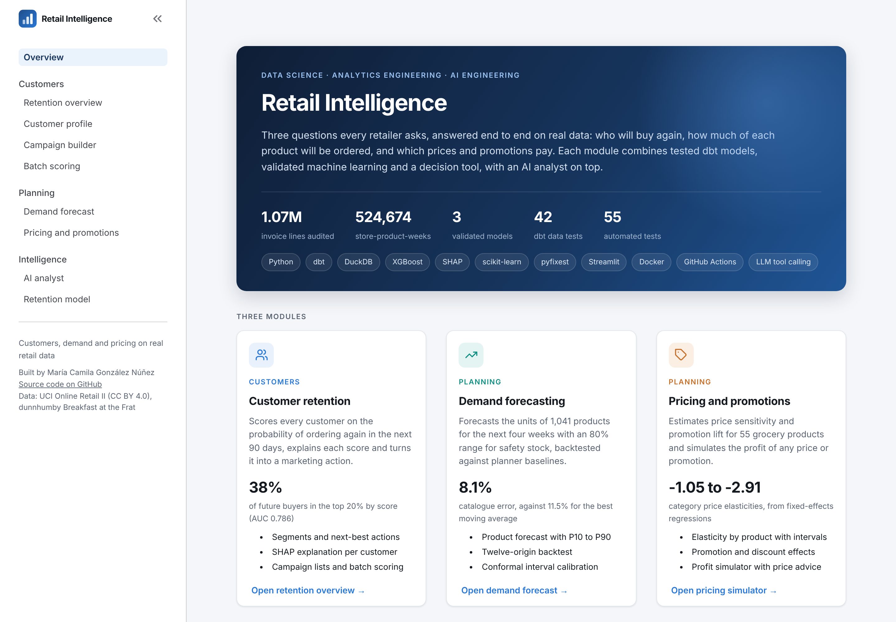 | 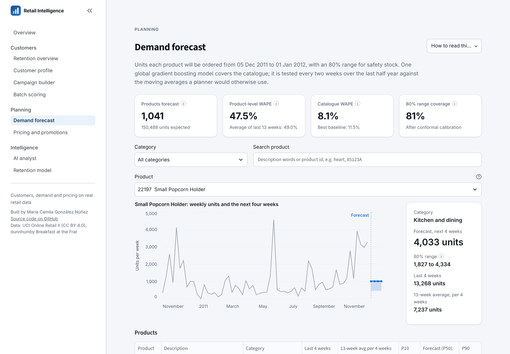 |
| 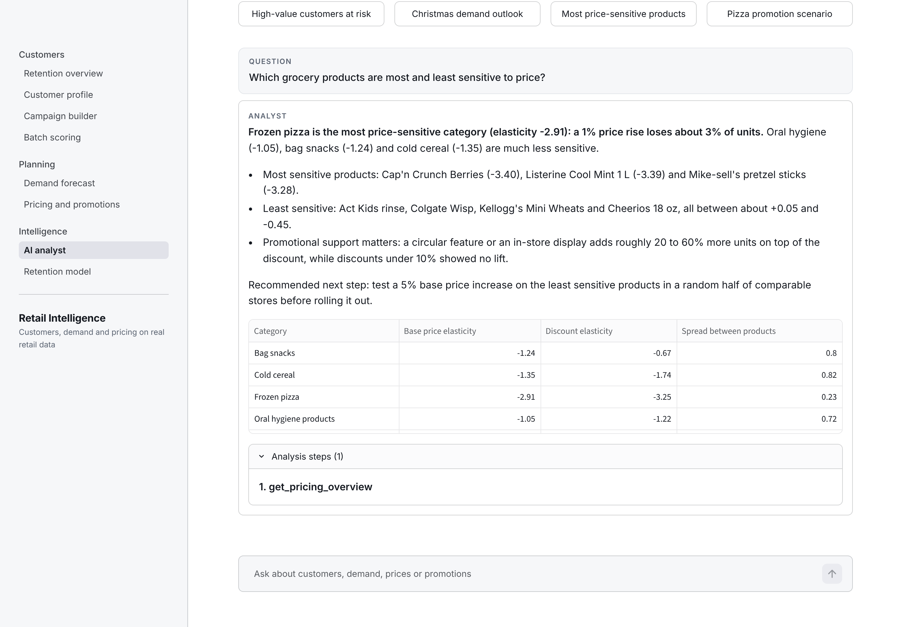 | 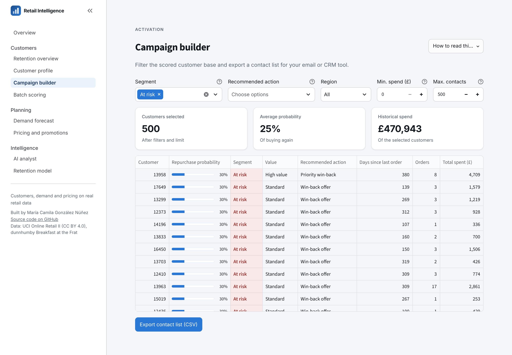 |
| 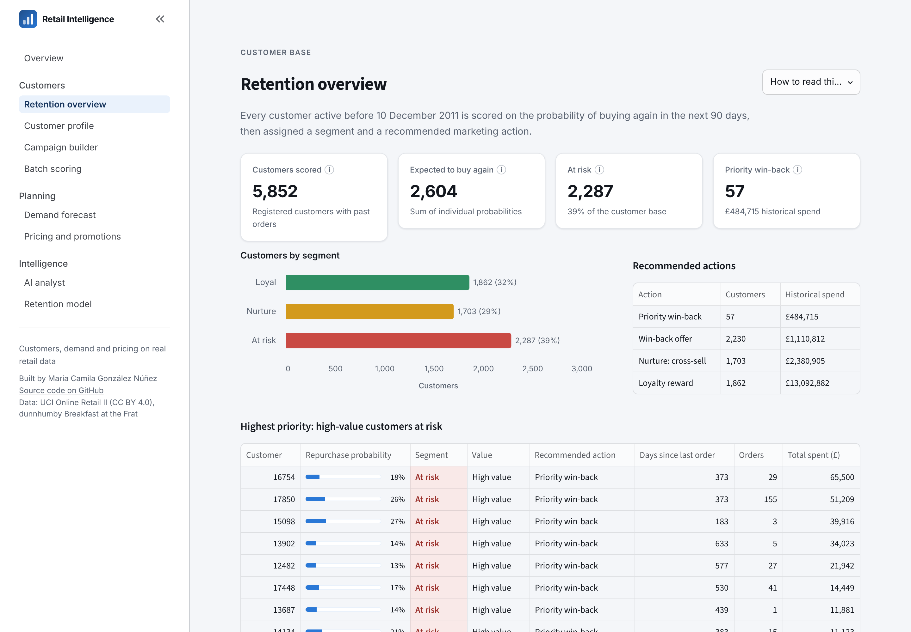 | 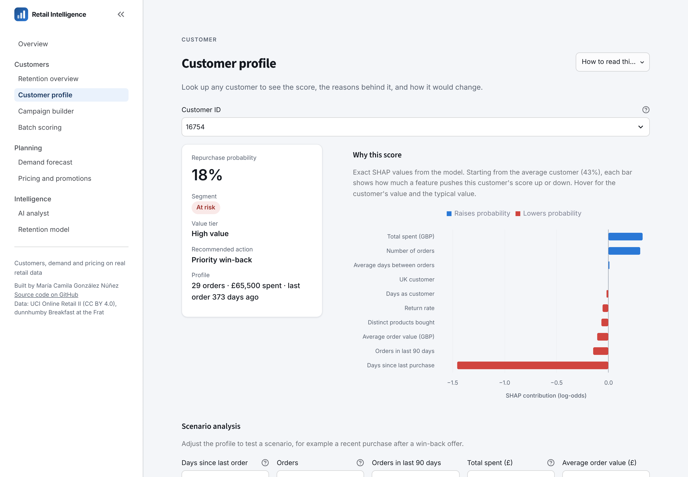 |

**AI analyst safety.** The language model never touches data directly; it can only call tools. SQL must be a single `SELECT` on three registered tables, is checked against a forbidden-keyword list, cannot read files or URLs, is wrapped in a 200-row limit, and runs on an in-memory DuckDB with external access disabled and its configuration locked. Every answer lists the tools and queries it used.

## Quickstart

Requirements: Python 3.11+.

```bash
git clone https://github.com/marianunez-data/retail-intelligence.git
cd retail-intelligence
pip install -e ".[app,pipeline,analysis,dev]"     # or: make install

# Fastest path: dbt outputs and model results are committed, so the app runs now
python -m retail_intelligence.train
streamlit run app/streamlit_app.py

# Full laboratory from the raw data (about 25 minutes on 2 cores)
make data        # downloads UCI Online Retail II and dunnhumby Breakfast at the Frat
make all         # ingest, dbt builds with tests, train, demand, pricing, the three notebooks, tests
```

To enable the AI analyst, copy `.env.example` to `.env` and add a free Gemini key (see [DEPLOY.md](DEPLOY.md)). Without a key, every other page works.

## Repository layout

```
retail-intelligence/
├── app/streamlit_app.py              Dashboard and AI analyst UI
├── data/
│   ├── raw/                          Source files (downloaded, never committed)
│   └── processed/                    dbt outputs and model results that the app reads
├── dbt/
│   ├── models/staging/               online_retail/ and dunnhumby/ cleaning rules
│   ├── models/intermediate/          retention/ and demand/ building blocks
│   ├── models/marts/                 retention/, demand/ and pricing/ marts
│   ├── seeds/                        product category keyword rules
│   ├── tests/                        leakage, grid, panel and range tests
│   └── macros/                       custom generic test and helpers
├── deploy/                           OCI setup script, Hugging Face Space files
├── docs/                             model cards, data dictionary, screenshots
├── models/                           trained retention model (built locally or in Docker)
├── notebooks/
│   ├── 01_retention_analysis.ipynb
│   ├── 02_demand_forecasting.ipynb
│   └── 03_pricing_and_promotions.ipynb
├── reference/aws/                    SageMaker, Lambda and API Gateway variant
├── reports/                          metrics files and every notebook figure
├── src/retail_intelligence/
│   ├── config.py                     paths, snapshots, features, business settings
│   ├── ingest.py, ingest_pricing.py  raw files to Parquet
│   ├── features.py                   dbt runner and retention snapshots
│   ├── modeling.py, train.py         retention model, validation, scoring
│   ├── demand.py                     forecasting, backtest, conformal intervals
│   ├── pricing.py                    elasticities, validation, simulator, recommendations
│   ├── engine.py                     scoring, explanations, guarded SQL
│   ├── agent.py                      tool-calling AI analyst
│   └── plotting.py                   shared figure style
├── tests/                            55 unit, agent and end-to-end pipeline tests
├── Dockerfile, Makefile, pyproject.toml
└── .github/workflows/ci.yml
```

## Deployment

The app reads the committed dbt outputs and model results; the retention model trains in about three seconds, at Docker build time or on the first visit.

- **Streamlit Community Cloud** (free, sign in with GitHub): point it at this repository and `app/streamlit_app.py`.
- **Hugging Face Spaces** (free, no card): `bash deploy/prepare_hf_space.sh <folder>` and upload.
- **Oracle Cloud Always Free** (alternative, always on): `bash deploy/oci_setup.sh` on an Ampere A1 VM.

Step-by-step instructions, including the free LLM key: [DEPLOY.md](DEPLOY.md). An AWS variant (SageMaker endpoint behind Lambda and API Gateway) is kept in [`reference/aws`](reference/aws).

## Development history

Built in milestones, each tracked as an issue and delivered through a pull request:

- [x] Data pipeline: ingestion and dbt models with data tests ([#1](https://github.com/marianunez-data/retail-intelligence/pull/1))
- [x] Customer retention model: notebook, validation, SHAP ([#2](https://github.com/marianunez-data/retail-intelligence/issues/2), [#6](https://github.com/marianunez-data/retail-intelligence/pull/6))
- [x] Demand forecasting: notebook, backtests, prediction intervals ([#3](https://github.com/marianunez-data/retail-intelligence/issues/3), [#7](https://github.com/marianunez-data/retail-intelligence/pull/7))
- [x] Pricing and promotions: notebook, elasticities, simulator ([#4](https://github.com/marianunez-data/retail-intelligence/issues/4), [#8](https://github.com/marianunez-data/retail-intelligence/pull/8))
- [x] Streamlit app, AI analyst and deployment ([#5](https://github.com/marianunez-data/retail-intelligence/issues/5), [#9](https://github.com/marianunez-data/retail-intelligence/pull/9))

## Documentation

- Model cards: [retention](docs/model_card_retention.md), [demand](docs/model_card_demand.md), [pricing](docs/model_card_pricing.md)
- [Data dictionary](docs/data_dictionary.md): sources, cleaning rules, marts and outputs for all three modules

## Data and license

- Chen, D. (2012). *Online Retail II* [Dataset]. UCI Machine Learning Repository. https://doi.org/10.24432/C5CG6D. CC BY 4.0.
- dunnhumby. *Breakfast at the Frat* [Source File]. https://www.dunnhumby.com/source-files/. Free for learning and case studies, all rights reserved: downloaded by the pipeline and never redistributed in this repository; only aggregated results are committed.
- Code: MIT License.
